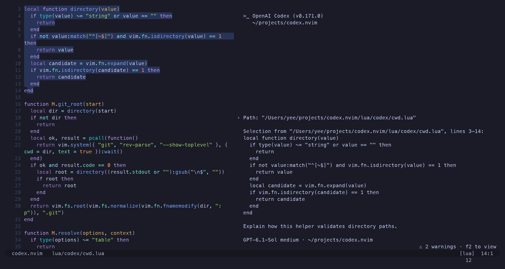
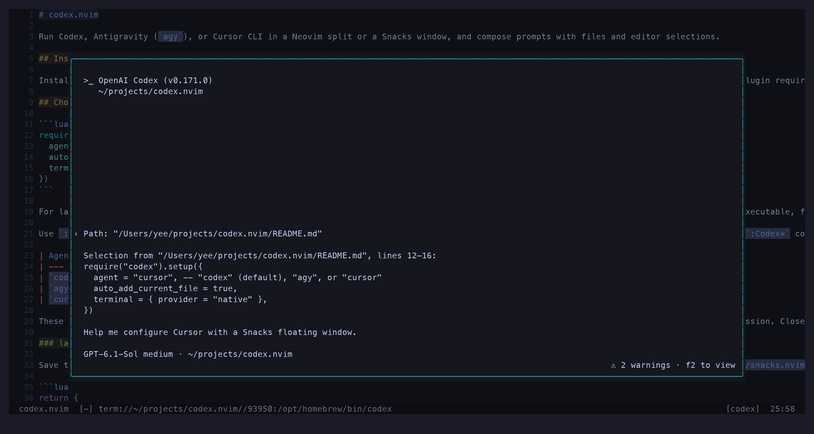

# codex.nvim

Run Codex, Antigravity (`agy`), or Cursor CLI in a Neovim split or a Snacks window, and compose prompts with files and editor selections.

## Preview

Add file paths with `:AgentAdd` and selected code with `:AgentSend`. Context stays in the CLI's draft until you press Enter to submit it.



Use a Snacks float to compose a prompt over your editor. Toggle the window with `:Agent` to return to your files while the session keeps running.



## Install

Install your selected CLI and make its command available on `PATH`: `codex`, `agy`, or Cursor’s `agent`. Complete the CLI’s login first. The plugin requires Neovim 0.11 or newer.

## Choose an agent

```lua
require("codex").setup({
  agent = "cursor", -- "codex" (default), "agy", or "cursor"
  auto_add_current_file = true,
  terminal = { provider = "native" },
})
```

For lazy.nvim, put `agent` in `opts`. `terminal.provider` selects the window backend independently. An explicit `terminal_cmd` overrides the executable, for example `terminal_cmd = "cursor-agent"`; `agent` still selects the CLI-specific parameters.

Use `:AgentOpen`, `:Agent`, `:AgentFocus`, `:AgentClose`, `:AgentAdd`, `:AgentTreeAdd`, and `:AgentSend` for the selected CLI. Every existing `:Codex*` command remains available as an alias, and the default keymaps continue to work. `:AgentResume [args]` (also `:CodexResume`) resumes the latest saved conversation. `:AgentYolo [args]` starts with the selected CLI’s permission-bypass option. Arguments apply only when starting a session.

| Agent | Default executable | Resume latest | YOLO argument |
| --- | --- | --- | --- |
| `codex` | `codex` | `resume --last` | `--dangerously-bypass-approvals-and-sandbox` |
| `agy` | `agy` | `--continue` | `--dangerously-skip-permissions` |
| `cursor` | `agent` | `--continue` | `--force` |

These permission flags follow each CLI’s own semantics; Cursor’s `--force` does not also disable its sandbox. The plugin manages one active session. Close it with `:AgentClose` before changing `agent`, resuming a conversation, or starting a YOLO session. Context is always inserted using bracketed paste and stays in the draft until you submit it. The Snacks Shift-Enter workaround is installed only for Codex; other CLIs receive their native key input.

### lazy.nvim with a Snacks float

Save this spec as `lua/plugins/codex.lua` if your lazy.nvim config imports `plugins`. Set `dir` to your local checkout. lazy.nvim loads `folke/snacks.nvim` as a dependency and loads Codex when you first run a command or press a listed key.

```lua
return {
  dir = vim.fn.expand("/path/to/your/checkout"),
  name = "codex.nvim",
  main = "codex",
  dependencies = { "folke/snacks.nvim" },
  cmd = { "Codex", "CodexOpen", "CodexFocus", "CodexClose", "CodexYolo", "CodexSend", "CodexAdd", "CodexTreeAdd", "CodexResume", "Agent", "AgentOpen", "AgentFocus", "AgentClose", "AgentYolo", "AgentResume", "AgentSend", "AgentAdd", "AgentTreeAdd" },
  opts = {
    auto_add_current_file = true,
    terminal = {
      provider = "snacks",
      snacks_win_opts = {
        position = "float",
        width = 0.85,
        height = 0.80,
        border = "rounded",
      },
    },
  },
  keys = {
    { "<leader>ac", "<Cmd>Codex<CR>", desc = "Toggle Codex" },
    { "<leader>ao", "<Cmd>CodexOpen<CR>", desc = "Open Codex" },
    { "<leader>af", "<Cmd>CodexFocus<CR>", desc = "Focus Codex" },
    { "<leader>aq", "<Cmd>CodexClose<CR>", desc = "Stop Codex session" },
    { "<leader>as", "<Cmd>CodexSend<CR>", mode = "x", desc = "Send selection to Codex" },
    { "<leader>ab", "<Cmd>CodexAdd<CR>", desc = "Add current file to Codex" },
    {
      "<leader>as",
      "<Cmd>CodexTreeAdd<CR>",
      desc = "Add file from tree",
      ft = { "NvimTree", "neo-tree", "oil", "minifiles", "netrw", "snacks_picker_list" },
    },
  },
}
```

### Native split

With the checkout on `runtimepath`, call `setup()` from your Neovim config. The native provider uses a regular Neovim split and requires only Neovim and the Codex CLI.

```lua
require("codex").setup({
  auto_add_current_file = true,
  terminal = {
    provider = "native",
    split_side = "right",
    split_width_percentage = 0.35,
    git_repo_cwd = true,
  },
})
```

For a native split with lazy.nvim, remove the Snacks dependency from the spec and use the options above as `opts`. For startup setup from `plugin/codex.lua`, set `vim.g.codex_auto_setup` to your options table before Neovim loads plugins.

## Default keymaps

`setup()` installs these mappings on available keys. Set `vim.g.mapleader` before setup if you use a custom leader.

| Key | Mode | Action |
| --- | --- | --- |
| `<leader>ac` | Normal | Show or hide the Codex terminal |
| `<leader>ao` | Normal | Open or focus the Codex terminal |
| `<leader>af` | Normal | Focus Codex from the editor or hide it when focused |
| `<leader>aq` | Normal | Stop the Codex session |
| `<leader>ab` | Normal | Add the current file path to the draft |
| `<leader>as` | Visual | Add the selected text to the draft |
| `<leader>as` | Normal in a supported file explorer | Add the selected path or paths to the draft |

Set `default_keymaps = false` in your initial setup to define your own mappings. If you use the lazy.nvim example above, replace or remove its `keys` entries as well.

## Use

1. Press `<leader>ao` or run `:CodexOpen`, then wait for the Codex prompt.
2. Press `Ctrl-\ Ctrl-N` to leave Terminal mode, then switch back to your editor window. Press `<leader>ab` to add the current file, or select text in Visual mode and press `<leader>as`. The Visual mapping captures character, line, and block selections, including unsaved edits.
3. Review the draft in Codex and press Enter to submit it.

Use `:CodexAdd docs/Release\ Notes.md` to add a specific path that contains spaces, or `:10,20CodexSend` to add lines 10 through 20 from the current buffer. In a supported file explorer, put the cursor on a file and press `<leader>as` in Normal mode.

| Command | Behavior |
| --- | --- |
| `:Codex [args]` | Toggle the terminal window. Hiding it keeps the session running. |
| `:CodexOpen [args]` | Open or focus the terminal. |
| `:CodexFocus [args]` | Focus Codex from the editor or hide the terminal when it is focused. |
| `:CodexClose` | Stop the Codex session. |
| `:CodexResume [args]` | Resume the latest saved session for the selected agent. |
| `:CodexYolo [args]` | Start a new session with `--dangerously-bypass-approvals-and-sandbox`. Close any running session first with `:CodexClose`. |
| `:CodexAdd [path]` | Insert a file or directory path into the draft. The current file is the default. Spaces are supported. |
| `:CodexTreeAdd` | Insert paths from nvim-tree, neo-tree, oil.nvim, mini.files, netrw, or a Snacks picker. |
| `:CodexSend` | Insert the Visual selection when invoked via a `<Cmd>` mapping. An Ex range such as `:10,20CodexSend` inserts whole lines. |

### Resume or start a YOLO session

Use `:CodexClose` to stop an existing session. Run `:CodexOpen resume --last` to resume the most recent saved session. Run `:CodexYolo` to start a session with approvals and sandboxing disabled.

### Set default CLI arguments

Set `default_args` in `setup()` or in your lazy.nvim spec's `opts`. Each list item is one CLI argument, including values that contain spaces. Defaults are placed after `terminal_cmd` and before arguments given to a command such as `:CodexOpen resume --last`. These settings apply when starting a new session.

For Codex, this makes `:Codex` and `:CodexOpen` start in YOLO mode by default. Use the selected CLI’s arguments when configuring other agents.

```lua
require("codex").setup({
  default_args = { "--yolo" },
})
```

### Track the current file

When `auto_add_current_file` is enabled, Neovim tracks the last named file buffer you visited. Returning to the running Codex terminal pastes its absolute path as `Current Neovim file: "…"` when the path has changed since the last automatic paste in that session. You can switch through several files before returning to Codex and only the latest path will be inserted. Unnamed and special buffers leave the tracked path alone.

The path is inserted at the draft cursor and is sent when you submit the draft. Earlier draft text can be edited in the TUI. For the first prompt after launch, wait for the composer and use `:CodexAdd` or switch to a file and return to Codex.

## Configuration

```lua
require("codex").setup({
  agent = "codex", -- "codex", "agy", or "cursor"
  -- terminal_cmd = "codex", -- Optional executable override, with CLI arguments
  default_args = {},
  focus_after_send = true,
  auto_add_current_file = false, -- Set true to add the current file when returning to Codex
  default_keymaps = true,
  terminal = {
    provider = "auto", -- Use Snacks if available, otherwise use a native split
    split_side = "right",
    split_width_percentage = 0.30,
    auto_insert = true, -- Enter Terminal mode when opening or returning to Codex
    auto_close = true,
    git_repo_cwd = false, -- Set true to start Codex in the current file's Git root
    fix_streamed_paste = "auto", -- Coalesce streamed terminal paste on older Neovim releases
  },
})
```

Set `terminal.provider` to `"native"` to always use a split. To use a Snacks float, set `terminal.provider = "snacks"` and `terminal.snacks_win_opts = { position = "float" }`. Use `terminal.cwd` to specify a fixed working directory, or `terminal.cwd_provider` to resolve it from the current file and Neovim working directory.


See [Development](DEVELOPMENT.md) for local checks.
